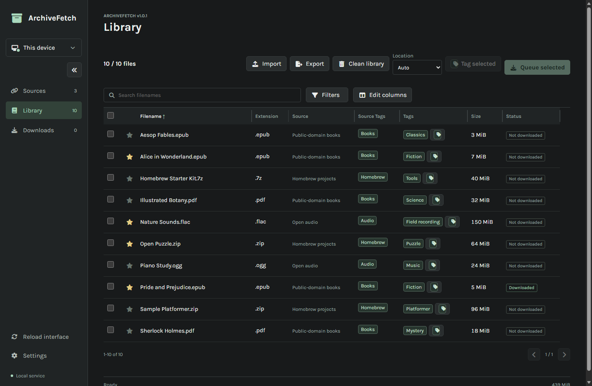
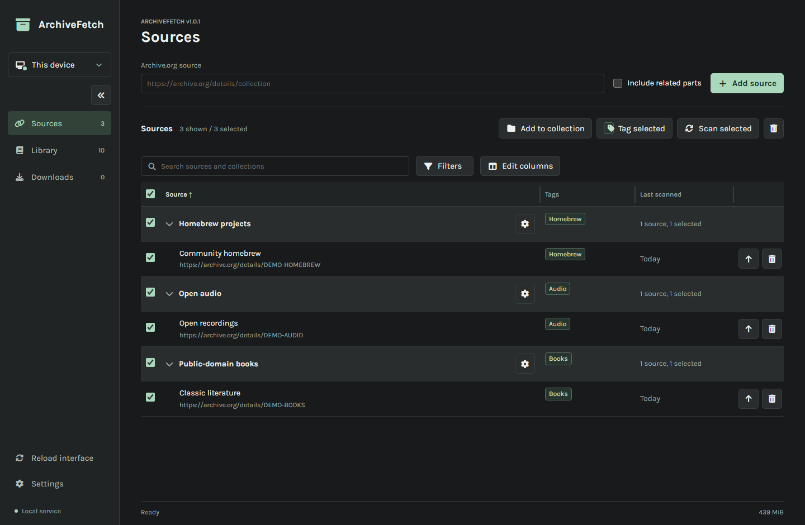
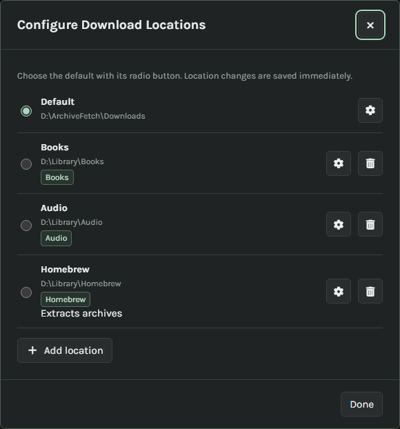
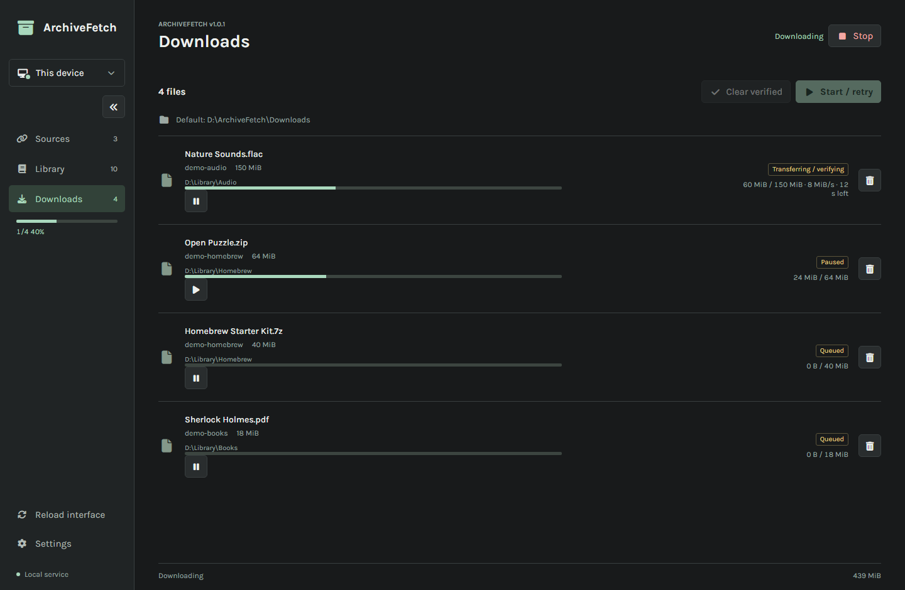

# ArchiveFetch

Bring Archive.org file lists together into one searchable library, organize them with collections and tags, and manage the downloads you choose.

**Current release: 1.0.1** | [Download](https://github.com/4beemaster/ArchiveFetch/releases/latest) | [Release notes](https://github.com/4beemaster/ArchiveFetch/releases) | [Report an issue](https://github.com/4beemaster/ArchiveFetch/issues)

ArchiveFetch runs on **Windows, Android and PS5**. The Windows and Android apps work independently using their own storage, or can connect to ArchiveFetch on a PS5 to manage the console's library and downloads.

No content or source lists are bundled with the apps. You provide your own Archive.org URLs. Use ArchiveFetch only for content you are authorized to download. It does not install or launch games; emulation, conversion and game installation are outside this project.

*Screenshots show the actual interface with illustrative demo entries, folders and download progress. Demo source URLs are placeholders, not bundled sources.*

## Features

- **Combined library:** Browse multiple Archive.org file lists with search, filters, sorting, tags and favorites.
- **Source collections:** Group related sources and give them shared tags.
- **Tag-based destinations:** Route downloads to named folders using file or source tags, with a default folder as the fallback.
- **Download controls:** Pause and resume individual files while the rest of the queue continues, with up to eight connections for large downloads.
- **Verified downloads:** Check completed files against the source's checksum and resume interrupted transfers where supported.
- **Automatic extraction:** Extract supported ZIP, 7z, RAR and tar archives after downloading, with settings for each destination.
- **PS5 remote control:** Manage console downloads from Windows or Android, and merge sources and library entries between devices.
- **In-app updates:** Automatically check for new releases, read release notes, and download and verify updates before confirming installation.

## Get started

Download the file for your platform from the [latest release](https://github.com/4beemaster/ArchiveFetch/releases/latest).

### Windows

1. Download and run `ArchiveFetch-1.0.1-windows-x64-setup.exe`.
2. Open ArchiveFetch from the Start menu or desktop shortcut.
3. If setup reports that Microsoft Edge WebView2 Runtime is missing, follow its link to install the runtime, then run setup again.

Setup installs for the current user without administrator access. Running a newer installer upgrades the same installation. Settings, library records, pairing and downloaded files are kept outside the installed program files and are not deleted by uninstall.

The Windows app uses an integrated window. Its local web server is not available to other devices; use the PS5 web interface for network access.

### Android

1. Download `ArchiveFetch-1.0.1-android-arm64.apk`.
2. Open it in your file manager, allow installation from that source if Android asks, and install ArchiveFetch.
3. Open the app and add a source.

Requires **Android 8 or newer**, an **ARM64 device** and an up-to-date Android System WebView. This is a sideloaded, debug-signed APK, not a Play Store release.

On Android 10 and newer, downloads initially go to **Downloads/ArchiveFetch**. To use another folder, open **Settings > Configure Download Locations** and select it through Android's folder picker.

**Android may prevent selecting the Downloads root itself.** Use the built-in Downloads/ArchiveFetch destination or choose an allowed subfolder instead. No broad "All files access" permission is required. Android 8-9 uses app-specific storage until you select a custom folder.

### PS5

Requires a **homebrew-enabled PS5 and a compatible ELF loader**. ArchiveFetch has been verified on firmware 13.60; this is not a claim of compatibility with every firmware or loader.

1. Send `ArchiveFetch-1.0.1.elf` to your running ELF loader, commonly on port **9021**.
2. Wait for ArchiveFetch's ready notification.
3. Open the **ArchiveFetch** tile in Media, or visit `http://YOUR-PS5-IP:8890/` from another device on the same network. The interface also offers a QR code for connecting.

The payload stops when the console restarts. Load it again after reboot, or use your existing Payload Manager startup configuration. ArchiveFetch recovers its web listener after rest mode.

## Using ArchiveFetch

### Add and organize sources

1. Open **Sources** and add an Archive.org item URL or a direct `_files.xml` URL.
2. Choose whether to include related items linked from the source's description.
3. Scan the source, then open **Library** to browse the results.
4. Select the files you want, choose a destination if needed, and add them to Downloads.

Related-item discovery follows description links one level deep, up to 128 items; it does not crawl reviews or guess collection URLs. A successful scan means the discovered file lists were read, not that an uploader's collection is complete. If a scan is incomplete, check its warning before downloading available files.

Use **Add to collection** to group sources. A source belongs to one collection at a time and shares its collection's source tags. When moving sources into or out of a collection, ArchiveFetch lets you choose which tags to keep.

Library separates **Source Tags** from file-specific **Tags**; its tag filter matches either. Search, filters, favorites and sortable columns help narrow the list. **Hidden file types** in Settings controls which extensions appear without removing them from the saved catalog. Removing an extension from that setting shows its files again without rescanning.

*Collections keep related sources together and give their members shared tags.*

### Choose download locations

Open **Settings > Configure Download Locations** to add named folders, assign tags and choose the default. Changes are saved immediately.

- **File:** Match file tags first, then source tags, then use the default folder.
- **Source:** Match source tags first, then file tags, then use the default folder.
- **Default:** Always use the default folder.
- **Auto (Default Setting):** Follow the configured preference; the initial preference is File.

Choosing a location explicitly in Library overrides tag routing. If tags match more than one location at the winning priority, ArchiveFetch asks you to choose before queuing the files.

Custom destinations are used as selected, without added source or collection subfolders. Files use their filename rather than the remote directory structure. Changing or removing a location does not move existing files or redirect downloads already queued.

On Android, folder access is limited to the grants provided by its system picker. If a grant is revoked, the location stays saved and is shown as unavailable; reselect it or choose another folder. Public downloads remain after uninstall, but app-specific files and partial-download staging are removed by uninstall or clearing app data.

*Assign tags to destinations and enable automatic extraction for individual folders.*

### Manage downloads

Files download one at a time. Files of at least 32 MiB can use **1-8 connections** each, configured under **Settings > Storage > Connections per download**; the default is four.

- **Pause** keeps a file's partial data and lets the remaining queue continue.
- **Resume** resumes that file, or queues it behind the active download.
- **Stop** stops the whole queue. **Start** resumes files interrupted by Stop, but leaves explicitly paused files paused.
- Sources can be added and scanned, and more files queued, while downloads run.

**Queues are not saved across app restarts.** Reselect interrupted files to resume their retained partials. Extraction cannot be paused, but can be stopped.

Completed transfers are checked for size and the source's SHA-1 or MD5 checksum. Files without either checksum cannot be queued. These checks detect accidental corruption; they do not prove that an uploader or file is trustworthy. Conflicting existing files require confirmation before replacement, and failed integrity checks discard the invalid partial download.

On Android, downloads are staged privately before being copied to the selected destination. **Allow space for both the staged file and its destination copy.** Background downloads use a foreground notification, but Android's time limits, force-stop and process termination still apply.

*Illustrative queue showing active, paused and waiting downloads; the displayed speed is demo data, not a performance benchmark.*

### Extract archives

Enable **Settings > Always extract archives after download**, or **Extract archives downloaded here** for an individual location.

Supported formats are `.zip`, `.7z`, `.rar` and `.tar`, including `.tar.gz`, `.tgz`, `.tar.bz2`, `.tar.xz` and `.tar.zst`. Files are extracted into a folder named after the archive, beside the download.

- Existing destination folders are not overwritten.
- Unsafe paths, links and special files are refused or skipped with a warning.
- Password-protected and multipart archives are unsupported.
- Failed or cancelled extraction removes only the output created by that attempt and keeps the archive.
- **Delete the archive after extracting** is off by default. When enabled, it removes the archive only after successful extraction and, on Android, successful publication to the destination.

**PS5 extraction requires the console's ELF loader to remain available on port 9021.** Windows and Android do not need an external extraction program. Android needs additional space for staged extracted files and their destination copies.

### History, cleanup and exports

Library tracks recorded downloads across locations and distinguishes missing, changed and unavailable copies. Editing a location does not delete its files or history.

**Clean library** separates removing library entries from deleting downloaded files. Review its counts and confirmation carefully. **Clean up missing downloads** removes stale records; unavailable locations, such as unplugged drives or revoked Android folders, require a separate opt-in.

Library exports a catalog as XML, CSV and a URL list. **Only XML can be imported back into ArchiveFetch.** These are catalog exports, not full backups: they do not restore source selections, collections, settings, file tags or favorites. Use Merge to transfer the supported library and source data between an app and a PS5.

## Connect Windows or Android to a PS5

Use the switcher at the top of the sidebar to choose **This device** or add a console by name, address and port (**8890** by default). **Find consoles on this network** can discover consoles on supported private home networks.

Once connected, Sources, Library, Downloads and Settings control the selected console. Downloads are saved on that console, not on the Windows or Android device. Switch back to **This device** for local downloads.

The app pairs with the console so it can reconnect later. Manage or revoke paired apps under the console's **Settings > Network > Paired devices**. Changing the console password does not revoke paired apps.

### Merge between devices

**Sources > Merge** copies selected or all sources, collections, catalog entries, file tags and favorites in either direction between this device and a saved console. Preview the changes and choose whether to add differing tags or leave them as they are.

Merge only adds data; it does not remove or replace existing entries. Settings, credentials, download locations, queues and download status are not copied.

### Console installation and updates

Windows and Android include the PS5 payload matching their own version. A saved console can show **Install ArchiveFetch** or **Update ArchiveFetch**, with confirmation before sending it. Start the console's loader first.

For a console already running ArchiveFetch 0.7.2 or newer, the app sends the update through port 8890; the loader does not need to be reachable from the other device. A first installation or an unresponsive console needs a reachable loader port, normally 9021.

The supported updater also synchronizes an eligible existing ArchiveFetch copy in itsPLK's Payload Manager, preserving its filename, slot and startup configuration. It does not add a missing copy or overwrite unsupported or ambiguous entries. A synchronization problem leaves a warning with a retry option. **Sending an ELF directly to the loader does not synchronize Payload Manager.**

## App updates

Windows, Android and the PS5 webpage automatically check public GitHub releases when the interface opens or reconnects. Android also checks when the app returns to the foreground. There is no periodic background polling.

When an update is available, use **View update** or open **Settings > ArchiveFetch updates**:

1. Read the release notes.
2. Choose **Download and verify update**.
3. After verification, choose **Install verified update** and confirm any system installer prompts.

**Nothing downloads or installs automatically.** Downloads and scans must finish before an app update starts. Verification checks the official SHA-256 manifest and GitHub asset digest when available; it detects corruption, not a compromised publisher.

- **Check for updates** runs a manual check and displays failures rather than reporting them as "up to date."
- **Skip this version** suppresses automatic notices for that exact version across restarts. Manual checks still show it, and newer versions are announced normally.
- **Include beta builds** is initially off for stable installations and on for beta installations. Your saved choice is preserved through upgrades.
- The check updates the app you are using, even while Windows or Android controls a console. A browser connected directly to PS5 checks the PS5 build.

Beta releases remain available while their upcoming version is being developed. After the stable release is verified, superseded beta downloads are hidden; their Git tags and source history remain available.

## Archive.org account access

Public files do not need credentials. Some restricted files require an account with permission to access them; seeing a file in a source's catalog does not guarantee download access.

Use **Get S3 keys** in Settings, or visit [Archive.org's IA-S3 key page](https://archive.org/account/s3.php), then enter both keys under **Settings > Archive.org IA-S3**. IA-S3 is the only supported account authentication method. Access failures are reported, not bypassed.

Keys are session-only unless you enable **Remember keys**:

| Platform | Saved-key protection |
|---|---|
| Windows | Encrypted for the current Windows user with DPAPI. |
| Android | Encrypted using Android Keystore. |
| PS5 | Stored in an owner-readable file, **not encrypted**. Other payloads with filesystem access may read it. |

Saved-key protection does not defend against a compromised device. **Forget** removes saved credentials and clears the current keys. S3 keys can authorize account writes as well as downloads: never share them, put them in screenshots or commit them to source control.

## PS5 network access and security

By default, the PS5 web interface accepts only the console itself and devices on its local network.

**Settings > Network > Allow external connections** requires a password and can only be changed from the local network. Outside browsers must sign in; saved browser sign-ins last up to 30 days. Changing the password signs those browsers out, but paired apps must be revoked separately.

**The PS5 interface and app-to-console connection use plain HTTP, not HTTPS.** A password does not encrypt the traffic. Credentials, cookies and keys entered over an untrusted connection may be exposed. **Use a VPN into your home network for access away from home rather than exposing port 8890 directly to the internet.**

Archive.org downloads and GitHub update requests use HTTPS with certificate verification.

## Troubleshooting and feedback

- **Android cannot select Downloads:** Use Downloads/ArchiveFetch or an allowed subfolder; Android can block the root folder.
- **A folder is unavailable:** Reconnect the drive or restore the Android folder grant. ArchiveFetch does not silently redirect those downloads.
- **A transfer was interrupted:** Reselect the file after restarting to resume retained partial data.
- **PS5 extraction will not start:** Check that the console's ELF loader is running on port 9021.
- **An update fails:** Read the error in Settings and retry explicitly. Do not clear application data as a first step.

Open logs from Settings; on PS5, use **Settings > Console log**. **Debug (Verbose)** adds diagnostic detail when needed. Logs can contain addresses, local paths and filenames, so review them before sharing. Never include credentials or pairing keys.

For a [bug report](https://github.com/4beemaster/ArchiveFetch/issues), include your platform, app version, steps to reproduce the problem and the exact error message. Physical-device behavior and third-party Android storage providers may differ from emulator tests.

## Build and contribute

See [CONTRIBUTING.md](CONTRIBUTING.md) for build instructions, command-line usage, tests and platform implementation notes.

## License

Copyright (C) 2026 4beemaster. ArchiveFetch is free software under the GNU General Public License v3.0 or later; see [LICENSE](LICENSE). Third-party components and their licenses are listed in [THIRD_PARTY_NOTICES.md](THIRD_PARTY_NOTICES.md).

ArchiveFetch is an independent project, not affiliated with or endorsed by Sony Interactive Entertainment or the Internet Archive. "PlayStation" and "PS5" are trademarks of Sony Interactive Entertainment Inc. Use it only on consoles you own. It comes with no warranty; see the license.
